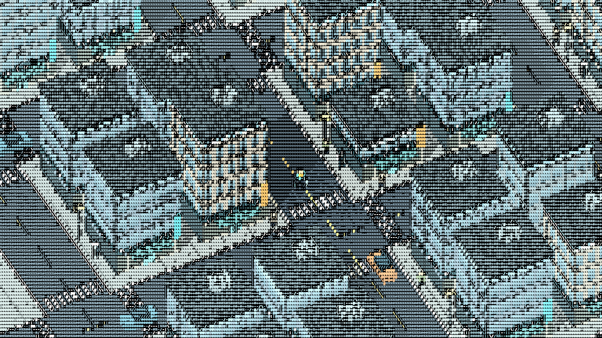
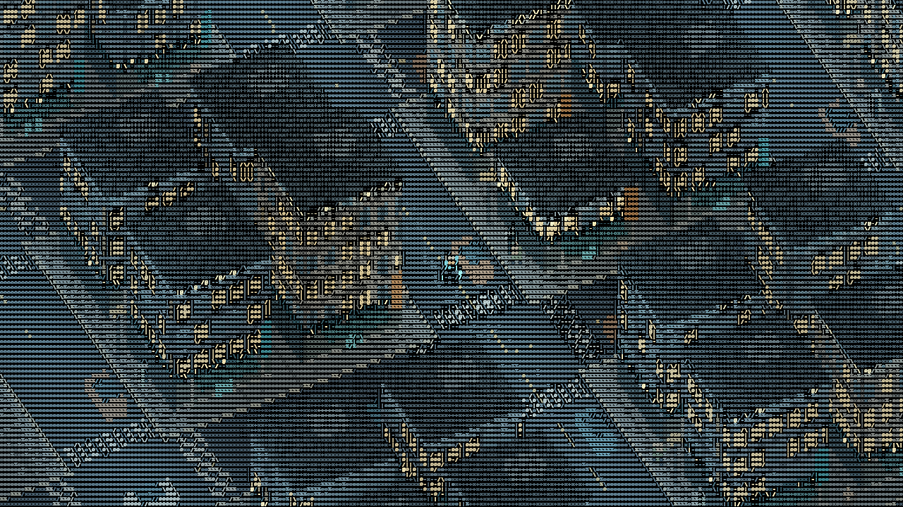
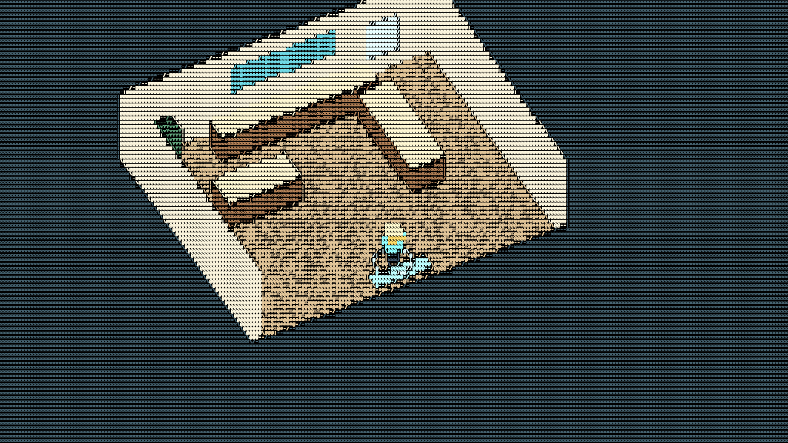

# GlyphWorld 0.3 — Tokyo / Hikari District

Cidade tecnológica explorável, inspirada em Tóquio, inteiramente renderizada por
um campo dinâmico de caracteres. Agora há movimento em duas direções no plano,
becos, portas, interiores, pedestres, carros e ciclo de dia/noite.

É uma **interpretação original e estilizada**, não um mapa geográfico de Tóquio.
As referências visuais fornecidas orientaram densidade urbana e verticalidade;
as imagens não são usadas como texturas nem redistribuídas no jogo.







## Executar no Windows

Instale Python **3.11+ (64 bits)**. Baixe este repositório em **Code → Download ZIP**,
extraia e abra **`start_windows.bat`**. A primeira instalação precisa de internet.
Se você já tem a versão 0.2, atualize os arquivos do projeto; a lista de dependências
continua compatível. Instalação manual, na pasta do projeto:

```powershell
py -3 -m venv .venv
.\.venv\Scripts\python.exe -m pip install -r requirements.txt
.\.venv\Scripts\python.exe -m glyphworld
```

O jogo começa às **09:00**, em modo manual, perto de uma avenida. O personagem usa
casaco ciano, cachecol âmbar e um círculo ciano no chão. Caminhe pelas ruas,
entre os prédios e até uma porta ciano na fachada. O título mostra **E: ENTER**
quando você está próximo o suficiente. Dentro do edifício, volte ao tapete ciano
e pressione E para sair exatamente pela mesma porta.

## Controles

| Controle | Ação |
|---|---|
| W / A / S / D | Caminhar pelo plano da cidade, com colisão nas construções |
| Espaço | Pular; não atravessa paredes nem sobe nos telhados |
| E | Entrar na porta próxima / sair próximo ao tapete ciano |
| Tab | Alternar controle manual e caminhada demonstrativa |
| P | Pausar personagem, trânsito, pedestres, chuva e relógio |
| N | Avançar seis horas |
| T | Congelar/retomar apenas o ciclo de dia/noite |
| Page Up / Page Down | Aumentar/diminuir exposição |
| `[` / `]` | Mais/menos densidade de caracteres |
| `+` / `-` ou roda do mouse | Aproximar/afastar câmera |
| R | Ligar/desligar chuva |
| L | Alternar iluminação e sombras |
| F1 | Mostrar/ocultar métricas no título |
| F2 | Final / luminosidade / orientação / profundidade / material |
| F12 | Salvar captura em `captures/` |
| Esc | Sair |

W/S seguem um eixo da cidade; A/D seguem o outro. A projeção oblíqua faz esses
eixos aparecerem inclinados na tela. Movimento diagonal é normalizado para não
ficar mais rápido. A pausa mudou de Espaço para **P**.

## O que mudou desde 0.2

- Campo mais legível: células padrão de 5×7, atlas com traços mais espessos,
  menos troca por símbolos finos em detalhes internos e exposição ajustável.
- Cena 3D em projeção oblíqua: volume real dos edifícios, telhados, unidades de
  serviço, janelas, pavimentos, vitrines, marquises, letreiros, árvores e postes.
- Paleta contida: concreto claro, vidro azul-acinzentado, ciano e âmbar.
- Noite com iluminação ambiente mínima; portas, ruas e personagem permanecem visíveis.
- Quarteirões gerados por coordenadas e seed, com avenidas e becos conectados.
- Colisões de jogador usam os mesmos limites dos edifícios desenhados.
- Interiores de loja e apartamento com móveis e colisão, acessíveis por todas
  as portas de edifícios gerados. A transição é instantânea, sem carregamento de arquivo.
- 18 pedestres próximos em rotas pelas calçadas e 18 veículos em rotas de avenida.
- Ciclo completo de 24 horas em oito minutos, configurável. Janelas e letreiros
  ganham presença à noite. Sombras direcionais simples das construções durante o dia.
- Recorte local de fachada quando ela esconde o personagem, para preservar navegação.

## Configuração

Edite `config.toml`: resolução inicial, tamanho das células, VSync, seed, chuva,
zoom, exposição e fonte. `start_hour` define a hora inicial; `day_seconds` define
quantos segundos reais correspondem a um dia inteiro.

```powershell
python -m glyphworld --hour 23
python -m glyphworld --autowalk
python -m glyphworld --frames 900 --no-vsync --benchmark benchmark.json --capture captures/final.png
```

O benchmark principal inclui apresentação e sincronização da GPU. Registra FPS,
tempo médio/p95, resolução, grade, driver e RSS. A memória de texturas é uma
estimativa das alocações conhecidas, não o uso total de VRAM. O objetivo de 60 FPS
continua dependendo de medição na aplicação e no computador usado.

## Renderização

1. Python gera uma vizinhança de 3×3 quarteirões, personagens e veículos. Uma
   textura RGBA32F contém até 512 caixas; a cena atual usa 376 no exterior.
   O cache procedural é limitado a 64 quarteirões. Não há um objeto Python por glifo.
2. `scene.frag` intersecta os raios da câmera com essa geometria, aplica detalhes
   procedurais por material e produz cor e metadados em buffers intermediários.
3. `field.frag` seleciona o caractere usando luminosidade, gradiente, contraste,
   material, textura e profundidade, com histerese temporal.
4. `glyph.frag` desenha a máscara do atlas. **Fora dos traços dos caracteres,
   o resultado é preto.** Nenhuma textura de cenário, sprite ou polígono é
   composto diretamente na imagem final. Os mapas de diagnóstico também usam glifos.

O atlas é compartilhado e gerado a partir de uma fonte monoespaçada local. A cena
usa três draw calls por quadro; a complexidade de interseção aumenta com a geometria,
mesmo mantendo o número de chamadas fixo. A grade padrão tem 256×103 = 26.368 células.

## Testes e estado de validação

```powershell
python -m unittest discover -s tests -v
python -m glyphworld --hidden --frames 120 --capture captures/smoke.png --benchmark benchmark-smoke.json
```

**20 testes de lógica passaram.** Os três shaders compilaram e executaram na GPU
Intel UHD Graphics em um harness nativo, incluindo dia, noite, interior, animação,
tempo congelado e mapas de diagnóstico. As imagens deste README são capturas reais.

**Limitação do ambiente de desenvolvimento:** a instalação de ModernGL/GLFW/psutil
permaneceu indisponível. Portanto a janela principal, os eventos de teclado e o
benchmark integrado ainda precisam ser verificados com as dependências instaladas.
Os números do harness **não são FPS da aplicação**. Veja [VALIDATION.md](docs/VALIDATION.md).

No Windows, o harness opcional usa NumPy, Pillow e o OpenGL do sistema:

```powershell
python tools/render_probe_windows.py
```

Ele atualiza as três imagens e `docs/gpu-probe.json`. A aplicação principal continua
multiplataforma: ModernGL/GLFW, sem importar esse harness específico do Windows.

Linux está preparado, mas ainda não foi testado:

```sh
python3 -m venv .venv
.venv/bin/python -m pip install -r requirements.txt
.venv/bin/python -m glyphworld
```

São necessários sessão gráfica, OpenGL 3.3+, bibliotecas de sistema do GLFW e uma
fonte monoespaçada. Configure `render.font` se a descoberta automática falhar.

## Limites atuais

Esta é uma base explorável de cidade, não uma simulação urbana completa. Carros e
pedestres têm trajetórias demonstrativas e não colidem com o jogador. A parada dos
carros antes de cruzamentos é uma aproximação por fase temporal, sem navegação de
trânsito real. Os interiores variam entre dois layouts; não há diálogo, inventário,
missões, persistência de alterações ou inteligência autônoma. O pulo é visual e
físico no eixo vertical, com colisão lateral mantida, sem plataformas elevadas.

A geração ainda usa uma malha regular, com variação de altura, largura, material e
tipo de interior. Prédios são compostos por caixas detalhadas proceduralmente.
A vizinhança se renova ao cruzar quarteirões; objetos muito distantes podem aparecer
ou desaparecer. O recorte de fachada é uma ajuda de câmera, não destruição do prédio.

Próximos passos: validar a janela completa, enriquecer os layouts e fachadas,
introduzir rotas de trânsito persistentes, colisões entre agentes, interiores
maiores e interação com a cidade. A IA de personalidade permanece fora desta etapa.
